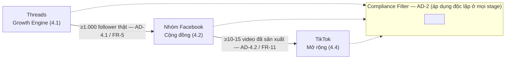

# Architecture Spine — Hành Trình Mẹ & Bé

## Design Paradigm

**Pipes-and-Filters**, áp dụng cho nội dung/audience thay vì code: mỗi kênh là một *filter* (Threads → Nhóm → TikTok) mà nội dung và người đọc chảy qua, mỗi filter có một *stage-gate* (ngưỡng cụ thể — follower hoặc số lượng nội dung đã sản xuất, tuỳ giai đoạn) phải đạt trước khi mở filter tiếp theo. **Compliance** (disclaimer + disclosure) không phải một filter riêng trong chuỗi — nó là một filter cross-cutting áp dụng độc lập ở mọi filter, không phụ thuộc filter nào đứng trước.

[ASSUMPTION: chọn paradigm này vì PRD đã mô tả đúng hình dạng pipeline có gate (FR-5, FR-16) cộng một quy tắc xuyên suốt (FR-12/13/14) — đặt tên đúng mô hình người vận hành đang nghĩ, không phát minh mô hình mới.]

## Invariants & Rules

### AD-1 — Ranh giới giai đoạn xác định loại affiliate được phép

- **Binds:** FR-8, FR-9 — áp dụng ở **mọi kênh** nơi nội dung giai đoạn xuất hiện (Threads, Nhóm, TikTok, và kênh mở sau này), không riêng kênh nào.
- **Prevents:** Gắn nhầm affiliate ngụ ý điều trị vào nội dung giai đoạn PCOS/TTC, hoặc trộn lẫn hai loại sản phẩm giữa hai giai đoạn.
- **Rule:** Mỗi bài chỉ thuộc đúng một giai đoạn, xác định bằng hashtag (AD-3): bài gắn `#PCOS101`/`#PCOSTTC` chỉ được gắn affiliate hỗ trợ lối sống (FR-8), không gắn affiliate đồ mẹ & bé (FR-9); bài gắn `#MeVaBe` chỉ được gắn affiliate đồ mẹ & bé (FR-9), không gắn affiliate hỗ trợ lối sống giai đoạn PCOS/TTC (FR-8).

### AD-2 — Compliance là cross-cutting filter, không phải bước riêng theo kênh

- **Binds:** `all` (FR-12, FR-13)
- **Prevents:** Kênh mới (TikTok, hoặc kênh tương lai) bỏ sót disclaimer/disclosure vì hiểu nhầm đó là "quy tắc riêng của Threads."
- **Rule:** Trước khi đăng bất kỳ nội dung nào ở bất kỳ kênh nào, áp dụng cùng một checklist: có trải nghiệm cá nhân → có disclaimer; có affiliate link → có disclosure. `[ADOPTED]` — đã được xác nhận trực tiếp trong quá trình làm PRD.

### AD-3 — Namespace phân loại nội dung dùng chung xuyên kênh (giai đoạn + độ sâu)

- **Binds:** FR-3, FR-9 — áp dụng mọi kênh, không tạo tên gọi/hashtag thay thế khi mở rộng sang TikTok hay kênh khác.
- **Prevents:** TikTok/Nhóm tự tạo hệ thống phân loại nội dung riêng không đồng bộ với Threads; hai bài cùng chủ đề bị gắn tầng khác nhau do không có tiêu chí rõ ràng.
- **Rule:** Ba hashtag namespace, loại trừ lẫn nhau, mỗi bài chỉ mang đúng một tag:
  - `#PCOS101` — bài trả lời câu hỏi "PCOS là gì / mới biết thì làm sao", không giả định người đọc biết thuật ngữ y khoa cơ bản.
  - `#PCOSTTC` — bài giả định người đọc đã biết PCOS là gì và đang hỏi tiếp "làm sao để có con".
  - `#MeVaBe` — nội dung giai đoạn Mang thai/Sau sinh (mang thai, sinh đẻ, nuôi con).

### AD-4 — Stage-gate là điều kiện duy nhất để mở kênh mới hoặc kích hoạt affiliate

- **Binds:** FR-5, FR-11, FR-16
- **Prevents:** Mở Nhóm, công bố kênh TikTok, hoặc đăng ký affiliate sớm vì cảm tính/nóng vội, trước khi đạt điều kiện đã chốt.
- **Rule:** Ba gate độc lập, không gate nào được bỏ qua bằng cảm tính:
  1. **Threads → Nhóm:** chỉ mở Nhóm khi Threads (kênh cá nhân) ≥1.000 follower thật.
  2. **Nhóm → TikTok:** chỉ công bố công khai kênh TikTok khi đã sản xuất sẵn ≥10-15 video (FR-11) — không phải một mốc follower, vì PRD không đặt số follower cho gate này.
  3. **Đăng ký affiliate:** Shopee Affiliate khi Threads ≥500 follower thật; TikTok Shop Affiliate (trạng thái chính thức) khi **kênh TikTok của chính chiến lược này** ≥1.000 follower — không tính follower Threads. Dưới ngưỡng TikTok Shop, dùng tính năng "chia sẻ link ngoài" thay thế — gate này không chặn FR-8/FR-9 (affiliate vẫn chạy qua Shopee/bio-link trong lúc chờ đạt ngưỡng TikTok Shop). `[ASSUMPTION: hai con số 500/1.000 lấy từ nghiên cứu chính sách nền tảng tại thời điểm viết brief — cần re-verify trước khi đăng ký thật, vì điều kiện chương trình affiliate có thể đã đổi.]`

### AD-5 — Tách bạch bài trần thuật và bài thương mại

- **Binds:** FR-14 — áp dụng **mọi kênh** (Threads, Nhóm, TikTok, kênh mở sau này), không riêng nơi affiliate link "sống" (Nhóm/bio-link).
- **Prevents:** Một bài/video vừa khẳng định hiệu quả điều trị PCOS vừa gắn affiliate link của chính sản phẩm được nhắc tới, ở bất kỳ kênh nào.
- **Rule:** Bài/video chia sẻ trải nghiệm cá nhân (không link) và bài/video giới thiệu sản phẩm hỗ trợ lối sống/mẹ & bé (có link, không khẳng định hiệu quả điều trị) luôn là hai đơn vị nội dung tách biệt.

### AD-6 — Nội dung không tái sử dụng nguyên bản giữa các kênh

- **Binds:** FR-11 (feature-specific NFR) — áp dụng khi mở thêm kênh TikTok khác (Deferred) và bất kỳ kênh video nào trong tương lai.
- **Prevents:** TikTok phát hiện nội dung trùng lặp/template giữa các kênh cùng thiết bị và giảm reach hoặc ban dây chuyền (rủi ro đã nêu ở `addendum.md` của brief).
- **Rule:** Nội dung TikTok phải được viết lại/dựng lại riêng cho định dạng video, không phải bản chuyển thể nguyên văn từ bài Threads/Nhóm; khi có thêm kênh TikTok khác, mỗi kênh sản xuất nội dung độc lập, không dùng chung template/clip.

## Consistency Conventions

| Concern | Convention |
| --- | --- |
| Naming (hashtag, series) | `#PCOS101` = nhập môn, `#PCOSTTC` = chuyên sâu, `#MeVaBe` = giai đoạn Mang thai/Sau sinh (AD-3); series đánh số dạng "Phần X/Y". |
| Data & formats (disclaimer, disclosure, link, lời mời) | Disclaimer nguyên văn: "đây là trải nghiệm cá nhân, không thay thế tư vấn bác sĩ". Disclosure nguyên văn kiểu "#quảngcáo" / "link tiếp thị liên kết". Link Shopee luôn qua bio-link (Flyn/beacons.ai/bio.link — công cụ cụ thể `[ASSUMPTION]` chưa chọn), không dán link trần trong bài Threads (FR-10). Lời mời vào Nhóm luôn kèm ít nhất một câu nêu lý do cụ thể, không chỉ dán link trần (FR-7). |
| Cross-cutting (checklist, nhịp đăng) | Checklist compliance (AD-2) áp dụng trước khi đăng, mọi kênh. Nhịp đăng cố định theo kênh: Threads 1 bài/ngày (chấp nhận đứt quãng tối đa 2 ngày liên tiếp trước khi coi là lệch nhịp), TikTok 7 video/tuần sau khi ra mắt. |

## Nền tảng & Công cụ

*Tương đương "Stack" cho một chiến lược không phải phần mềm: các nền tảng/công cụ bên ngoài được "pin" — thay đổi chính sách/gói của chúng là rủi ro ngoài tầm kiểm soát, ghi nhận ở đây để biết khi nào cần rà lại spine.*

| Nền tảng / Công cụ | Vai trò |
| --- | --- |
| Threads | Kênh chính, Growth Engine (4.1) |
| Facebook Groups | Cộng đồng sở hữu, nơi đặt affiliate chính (4.2) |
| TikTok | Mở rộng Phase 3 (4.4) |
| Shopee Affiliate | Kênh hoa hồng giai đoạn PCOS/TTC + mẹ & bé |
| TikTok Shop Affiliate | Kênh hoa hồng song song với Shopee |
| Claude Team, Gemini | Soạn kịch bản/nội dung (Threads, TikTok) |
| Google Flow (free tier) | Sản xuất video/giọng đọc AI cho TikTok — `[ASSUMPTION]` free tier đủ dùng, chưa kiểm chứng |
| Bio-link tool (Flyn/beacons.ai/bio.link) | Rút gọn link Shopee — `[ASSUMPTION]` chưa chọn cụ thể tool nào |

## Capability → Architecture Map

| Capability / Area (PRD) | Lives in | Governed by |
| --- | --- | --- |
| Growth Engine trên Threads (FR-1..FR-4) | Threads | AD-2, AD-3 |
| Cộng đồng — Nhóm Facebook (FR-5..FR-7) | Facebook Groups | AD-2, AD-4 |
| Duyệt bài trong Nhóm (FR-15) | Facebook Groups | Vận hành ngày-ngày, không có AD riêng (mức rủi ro thấp, một mình vận hành) |
| Cơ chế kiếm tiền theo giai đoạn (FR-8, FR-9, FR-10, FR-16) | Nhóm Facebook + bio-link | AD-1, AD-3, AD-4 |
| Mở rộng TikTok (FR-11) | TikTok | AD-2, AD-3, AD-4, AD-6 |
| Tuân thủ & niềm tin (FR-12..FR-14) | Xuyên suốt mọi kênh (kể cả kênh mở sau này) | AD-2, AD-5 |

## Deferred

- **Sự cố nền tảng (khoá/hạn chế tài khoản, thay đổi thuật toán/chính sách ảnh hưởng tới một AD nào đó)** — không quyết định trước cách xử lý cụ thể vì phụ thuộc tình huống thực tế; điều kiện quay lại: nếu xảy ra, dừng sản xuất theo spine hiện tại và chạy lại `bmad-architecture` (Update) để đánh giá AD nào bị ảnh hưởng trước khi tiếp tục.
- **Kênh YouTube truyện kể** — chờ đánh giá lại rủi ro chính sách nội dung AI cho trẻ em trước khi spine này mở rộng bao trùm kênh đó (PRD §5, §6.2).
- **Các kênh TikTok chủ đề khác** (đồ ăn dặm...) — chờ kết quả kênh TikTok đầu tiên; khi mở, sẽ cần AD mới cho việc tránh trùng nội dung giữa các kênh TikTok cùng thiết bị (rủi ro đã nêu ở `addendum.md` của brief).
- **Quy trình onboarding cộng tác viên/thuê ngoài** — chưa cần vì vận hành một mình trong 6 tháng đầu (PRD §5); khi có, AD-2 (checklist compliance) sẽ cần một cơ chế thực thi mạnh hơn là tự giác.
- **Công cụ kỹ thuật cụ thể cho bio-link và theo dõi đơn hàng affiliate** — ngoài phạm vi PRD (không có phần mềm nội bộ); chọn công cụ cụ thể là quyết định vận hành, không phải quyết định kiến trúc.
